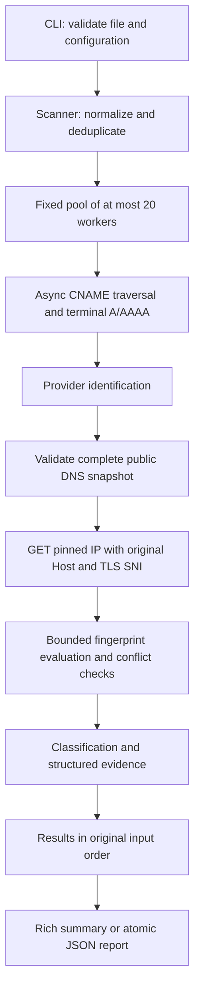

# Dangl3 V2 architecture

## Pipeline

Unknown providers and incomplete DNS return before HTTP. Provider DNS-only
coverage stays unknown after HTTP inspection; provider-related terminal DNS
absence is at most suspicious. No path claims resources or verifies exploitation.

## Module responsibilities

| Module | Responsibility |
| --- | --- |
| `cli.py` | Typer commands, validation, stderr logging, JSON stdout and cancellation exit status. |
| `inputs.py` | Hostname normalization, file/line/target bounds and stable deduplication. |
| `scanner.py` | Fixed workers, failure isolation, timings, deterministic order and classifications. |
| `async_dns_resolver.py` | Native asynchronous CNAME/A/AAAA queries, lifetimes, loops and canonical-name consistency. |
| `dns_resolver.py` | Compatible V1 synchronous DNS interface with the same audit fixes. |
| `network_safety.py` | URL scope, complete answer validation, IP-family checks, special-use blocks and literal-IP URLs. |
| `async_http_client.py` | Native async requests, target-local pools, wall-clock deadlines and bounded raw streaming. |
| `http_client.py` | V1 synchronous inspector and shared response/redirect evidence helpers. |
| `async_utils.py` | Await native operations; offload trusted legacy synchronous injections to threads. |
| `providers.py` | Label-bounded suffix and exact-name matching, retaining ambiguous chains. |
| `fingerprints.py` | Bounded JSON loading, schema checks, literal/title matching and coverage metadata. |
| `models.py` | Typed configuration, DNS/HTTP/results and structured evidence. |
| `reporting.py` | Additive schema-1 reports, atomic files and Rich rendering. |

## Network safety boundary

The original logical URL identifies the authorized hostname. The actual request
URL passed to httpx contains a validated IP literal. `Host` and the httpcore
`sni_hostname` extension retain the original hostname. The default transport
requires CA verification and hostname checks; it does not disable TLS verification
or trust environment proxies. Tests exercise the real httpx/httpcore transports
with fake TCP backends to assert the IP, SNI and verification settings.

The initial DNS result is consumed once by HTTP without another hostname lookup.
Each redirect or HTTP fallback resolves fresh DNS and checks every answer before
pinning the next request. A DNS change after validation cannot change the literal
IP in that request. CNAME attribution changes during redirects are recorded and
cannot yield a potential finding. Separately, A/AAAA answer canonical names must
match the terminal hostname from the explicit CNAME traversal.

Only exact same-hostname redirects on standard ports are allowed, without
credentials or HTTPS downgrade. Private/special-use IPs, mixed answer sets,
scoped/transition IPv6 and known metadata/platform addresses are blocked.
Configured DNS resolvers themselves may be internal; this policy governs HTTP
destinations, not access to the user's configured DNS infrastructure.

Pools and cookies are local to each target. Since httpcore pools are keyed by the
pinned IP origin, sharing a pool between different hostnames would risk reusing
a TLS session with the wrong hostname. V2 deliberately avoids cross-target
pooling. Within a target, explicitly empty redirect responses are consumed to
their protocol end so a connection can be reused; other redirect bodies close
unread. Source URLs in fingerprint metadata are never fetched by the scanner.

## Work and resource bounds

Inputs are validated before network work, capped at 10,000 unique names. An
iterator assigns one target at a time to each worker without an await between
claiming its index and starting it. At most 20 worker tasks exist. A single target
uses the current task directly. No producer queue or per-target future list is
created. Input/results storage remains O(N); in-flight I/O is O(concurrency).

Each worker performs DNS and HTTP operations sequentially. Native DNS queries
have explicit lifetimes; async HTTP request deadlines cover redirect DNS, TCP,
TLS, headers and raw body reads. Default response retention is 64 KiB. The stack
may buffer additional bytes, so this is an inspection-memory cap, not an exact
wire-byte guarantee. Compressed bodies are rejected, and no assets are fetched.
The default HTTP transport has one connection per target and zero automatic retries.

`asyncio.TaskGroup` cancels and awaits workers when the batch is cancelled.
`CancelledError` is not swallowed by per-target exception handling. Client/stream
contexts close on timeout and cancellation. `asyncio.run` handles CLI Ctrl+C;
the CLI returns 130 and publishes no partial report. Trusted synchronous V1
injections run in worker threads and cannot be forcibly terminated; production
uses the native async path. The fingerprint database and CA context are initialized
once per scanner, not once per target. Overlapping batches on one Scanner are rejected.

## Evidence and report compatibility

Rules have explicit sources and limitations. Matching incomplete/truncated bodies
is forbidden; negative indicators and missing/duplicate required headers produce
ambiguous evidence. Provider recognition alone cannot produce a potential finding.
Matched indicators after redirects, DNS changes or transport errors are capped
at suspicious. Unknown coverage and conflicting evidence stay unknown.

Schema version 1 is retained because existing keys and types remain intact.
`evidence` remains a list of strings. `structured_evidence` adds category, message,
optional fingerprint ID and sources. Provider dictionaries gain coverage fields.
Durations, original spelling, explanations, limitations, warnings and HTTP
destination details are additive. Strict consumers must allow additional keys.
No HTTP body or cookie is serialized. CLI batch duration is wall-clock elapsed
time; standalone report construction labels a sum-of-target-duration fallback.

The OS, routing, recursive DNS and CA store remain trusted. See
[security-audit.md](security-audit.md) for findings and residual limitations and
[provider-research.md](provider-research.md) for source/fixture decisions.
