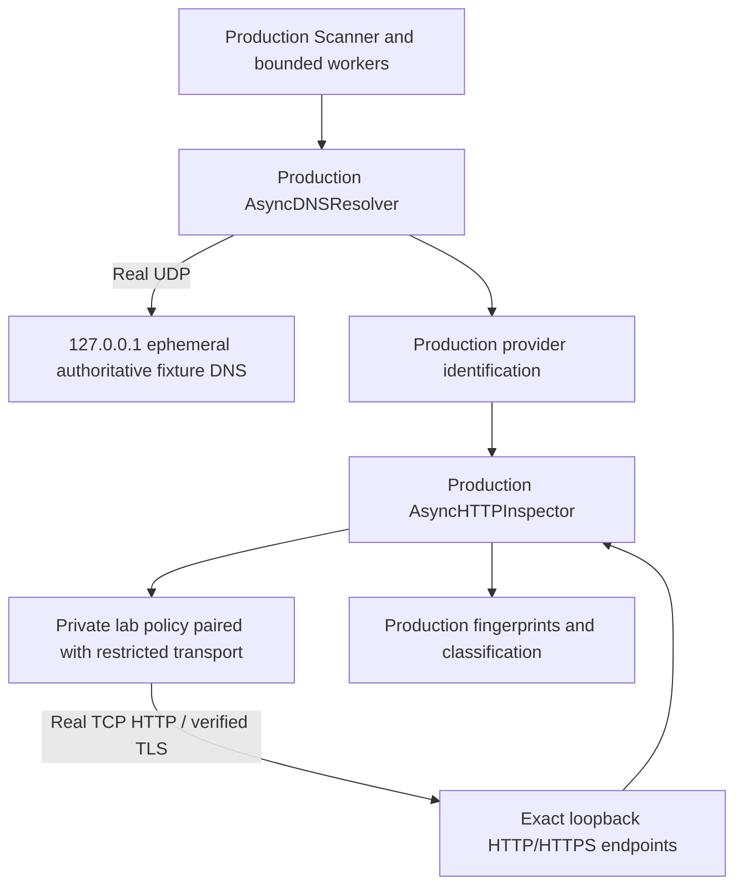

# Dangl3 local integration lab

This is a reproducible local demonstration of Dangl3 v0.2.0 using real DNS
packets, TCP connections, HTTP responses and verified HTTPS. **Every finding is
synthetic. A simulated potential takeover is not a real vulnerability.**

No AWS/Vercel/GitHub accounts, public DNS changes, vulnerable infrastructure,
Docker, root privileges, system DNS changes or system CA installation are needed.
Runtime uses Python 3.11+ and Dangl3's existing dependencies. No additional
runtime packages or OpenSSL command-line executable are required.

## Run on Kali or another Linux distribution

From the existing repository, with Python 3.11+ and venv support installed:

```bash
python3 -m venv .venv
source .venv/bin/activate
python -m pip install -e '.[dev]'

python -m integration_lab.runner
python -m pytest -q tests/integration
python -m pytest -q
dangl3 --version
dangl3 scan --help
```

Dependency installation may need a package cache or Internet access. **Executing
the installed lab and tests requires no Internet connection.** The runner also
ships in the wheel, so it can run outside the source checkout after installation.

The runner exits 0 when every scenario and invariant passes, 1 on a comparison
failure, and 130 on Ctrl+C. It reports the ephemeral endpoints, a scenario table,
ordering/concurrency/safety checks, and cleanup results. Ports vary between runs.
All three listeners bind exclusively to `127.0.0.1` on OS-assigned ports above
1023: one UDP DNS listener, one TCP HTTP listener and one TCP HTTPS listener.

## Layout and architecture

```text
integration_lab/
├── __init__.py
├── README.md
├── dns_server.py
├── http_server.py
├── scenarios.py
├── transport.py
├── runner.py
└── fixtures/
    ├── README.md
    ├── responses.json
    ├── lab-ca.pem
    ├── server-cert.pem
    └── server-key.pem
```

`transport.py` is separate to make the test-only network boundary easy to review.
The HTTPS listener and certificate fixtures add real TLS coverage without
disabling certificate checks.



The scanner, provider database, fingerprint matcher, classification engine,
response parser, body limits, redirect processing and worker pool are the
production implementations. No fake scanner, mock resolver, response-returning
transport or modified fingerprint database is used. The local servers synthesize
the network responses; the transport delegates to a real httpx/httpcore transport.

## Synthetic DNS

Scan targets are reserved names such as `missing-s3.dangl3.test`. The UDP server
uses dnspython to parse real queries and serialize authoritative replies. It has
no resolver/forwarding client and never forwards queries.

Examples:

```text
missing-s3.dangl3.test
  CNAME missing-s3.s3-website-us-east-1.amazonaws.com
  terminal A 127.0.0.1

missing-vercel.dangl3.test
  CNAME missing-vercel.vercel.app
  terminal A 127.0.0.1
```

Provider-style terminal names are synthetic DNS data. Although their suffixes
resemble real providers, queries go only to this local DNS server. Dangl3's
injected dnspython resolver is created with `configure=False`, its only nameserver
is `127.0.0.1` at the assigned UDP port, and its cache/search list are disabled.
The system resolver settings and `/etc/hosts` remain untouched.

The server supports CNAME and A records, returns empty AAAA records, uses TTL 0,
and leaves recursion availability unset. Known names queried for unsupported
types return NOERROR/NODATA; unknown names return NXDOMAIN. Unsupported classes
are refused and malformed query packets receive FORMERR where possible.

The rebinding case first resolves to `127.0.0.1`. Sending its first redirect
response triggers a state transition in the DNS fixture: subsequent A answers
for that exact target become `169.254.169.254`. This is event-driven, without
timing sleeps. The next request is blocked before any metadata connection.

## HTTP and HTTPS fixtures

`fixtures/responses.json` contains minimal synthetic responses based on the
**existing** S3 and Vercel rules. It adds no provider indicators. S3 responses
require the missing-bucket code/message and AmazonS3 header; Vercel uses its
existing missing-deployment code. All requests are GETs, dispatched by the
original `.test` Host header.

The fixture server accepts only known scenario hosts and `/` or
`/after-redirect`, bounds request headers, and closes each response connection.
The body-limit case exceeds the harness's 1 KiB inspection cap. The incomplete
case advertises a larger Content-Length than it sends, then closes the socket,
exercising a real HTTP framing error. Neither can yield a positive fingerprint.

Vercel and GitHub scenarios use actual HTTPS. The lab-only CA is trusted by the
lab transport's own SSL context; the original hostname is still sent as TLS SNI
and verified against the `.test` certificate. TLS verification is never disabled.
Tests also exercise real certificate failures for an untrusted CA and a wrong
hostname. Production/default SSL contexts do not acquire trust in this CA.

## Isolation and fail-closed behavior

Normal Dangl3 rejects loopback/private HTTP destinations. That policy remains
the default everywhere, including when pointed at this local DNS server.

The only production change is an internal `_destination_policy` injection point
on `AsyncHTTPInspector`. It requires an explicit transport factory and has no
CLI flag, environment variable or `ScanConfig` option. The scanner never imports
the lab automatically. The policy and transport are explicitly paired by a live
`LabScope` inside this harness:

1. Keep the production same-hostname, scheme and standard logical-port checks.
2. Require an exact scenario hostname, its exact fixture CNAME chain, a complete
   DNS result, only A `127.0.0.1`, and no AAAA/error records.
3. Require the matching live `LabTransport` instance for this scope. A normal
   transport, another lab's transport, or a closed scope cannot obtain permission.
4. Pin the request to this instance's exact loopback HTTP/HTTPS port. The endpoint
   map is immutable; no arbitrary public/private/other-loopback endpoint is allowed.
5. Issue a single-use permit binding the URL to the original Host/SNI. The
   transport rejects unapproved/replayed requests, altered Host/SNI, non-GET
   methods, other routes, credentials, query strings and other destinations.
6. Use a real proxy-disabled, retry-disabled HTTP transport with certificate and
   hostname verification enabled. Only its SSL context trusts the fixture CA.

Without the policy, the production loopback check blocks the request. Without
the matching lab transport, the lab policy refuses it. Thus removing or
misinstalling a lab component fails closed; no public "placeholder" IPs are used
to trick the production destination guard.

Integration tests additionally install a socket-level allowlist scoped to
`tests/integration/`: only registered lab TCP/UDP endpoints and DNS replies to
participating clients are allowed. Public DNS lookups and all other connections
remain forbidden. Ordinary unit tests retain their blanket network ban. The
Ctrl+C subprocess test runs the same closed local harness in a child process.

This is a trusted Python test extension, not a sandbox for arbitrary Python
code. Other local users/processes can access a temporary loopback listener while
it exists, but cannot make the fixture servers forward queries or requests.
Do not reuse the lab policy, fixture CA or publicly committed test key in production.

## Scenarios and expected results

| Scenario | Network behavior | Expected result |
| --- | --- | --- |
| `missing-s3` | S3 CNAME and full specific HTTP 404 fingerprint | `POTENTIAL_TAKEOVER` |
| `missing-vercel` | Vercel CNAME and verified HTTPS missing-deployment response | `SUSPICIOUS` |
| `github-dns-only` | GitHub CNAME and generic HTTPS 404 | `UNKNOWN` |
| `generic-404` | Supported S3 target, generic HTTP 404 | `NO_EVIDENCE` |
| `healthy` | Supported S3 target, HTTP 200 | `NO_EVIDENCE` |
| `ambiguous` | Missing-bucket text conflicts with a negative key indicator | `UNKNOWN` |
| `body-limit` | Fingerprint followed by data beyond the 1 KiB inspection cap | `UNKNOWN` |
| `unsafe-redirect` | Redirect to an unrelated `.test` hostname | Blocked; `UNKNOWN` |
| `dns-rebinding` | Same-host redirect after DNS changes to a metadata IP | Blocked; `UNKNOWN` |
| `incomplete-http` | Fingerprint body with incomplete Content-Length framing | `UNKNOWN` |
| `nxdomain` | Actual DNS NXDOMAIN reply, no HTTP | `NO_EVIDENCE` |
| `cname-loop` | Two actual CNAME replies form a loop, no HTTP | `UNKNOWN` |

The expected summary is **1 potential, 1 suspicious, 3 no evidence and 7 unknown**.
There are 12 unique targets, 10 HTTP/HTTPS requests, and a duplicate input that
must not be scanned again. Findings are never rewritten to force expectations.
Blocked/incomplete cases are validated through request counts and recorded errors,
not merely the classification label.

## Determinism, concurrency and cleanup

The default runner uses 3 production workers. A first-wave event barrier waits
until the corresponding HTTP requests have all arrived. The first input's
response is deliberately held until its peers' responses are sent. This verifies
actual simultaneous I/O and stable input ordering without arbitrary sleeps.

Tests use limits 1, 2, 3 and 20; with only 10 HTTP scenarios, the 20-worker case
has a peak of 10 HTTP requests. Results are checked per target, and errors in the
loop, NXDOMAIN, redirect and incomplete-body scenarios must not affect other targets.

An `AsyncExitStack` owns both HTTP listeners, the UDP endpoint and scoped
transports. Scanner cancellation closes clients; harness shutdown cancels and
awaits server handlers and releases ports even on exceptions. Tests rebind the
released listener ports and send a real SIGINT to a child runner held at the
barrier, checking exit code 130 and completed cleanup.

## Limitations

- This validates protocol handling and configured classification behavior, not
  real provider behavior, ownership, claimability or detection accuracy.
- DNS is a small authoritative fixture server, not a full recursive resolver.
  DNSSEC, DNS-over-TCP, arbitrary zones, IPv6 listeners and DNS retry/failure
  conditions beyond the explicit scenarios are not modeled.
- It uses short local responses and a 1 KiB body cap, rather than measuring
  performance under Internet latency or production-scale traffic.
- The fixed lab certificate is valid from 2026-10-23 through 2036-10-20. Clocks
  outside that window or changed trust policies fail TLS verification; regenerate
  the fixture certificates for maintenance instead of disabling verification.
- The SIGINT test uses POSIX process signaling/select, matching the supported
  Kali/Linux demonstration environment.
- Servers bind only to IPv4 loopback; an OS/environment that forbids local sockets
  cannot run this lab. Such failures must be reported, not skipped as passes.

Provider source decisions are documented in
[provider-research.md](../docs/provider-research.md).
